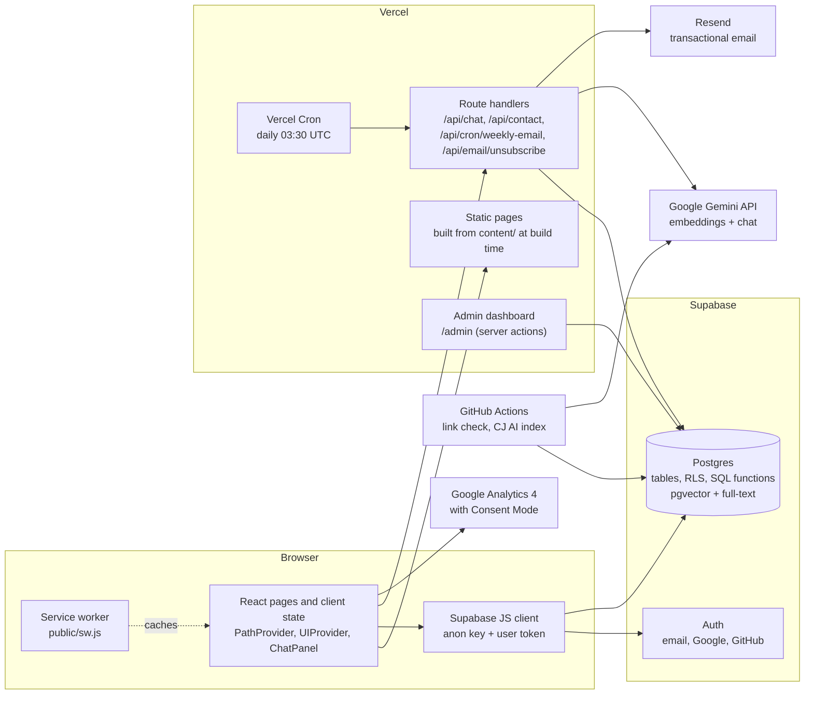
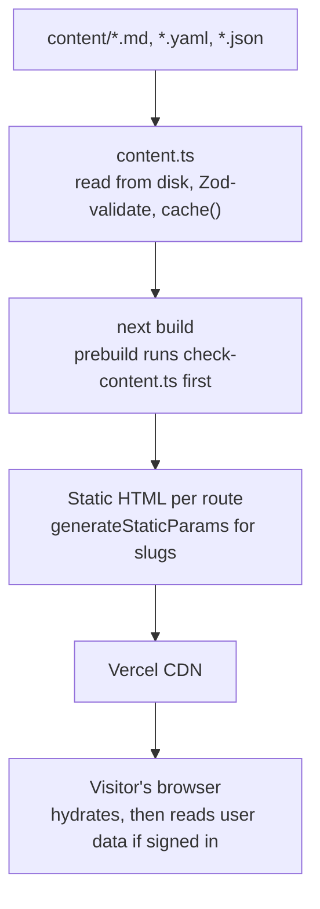
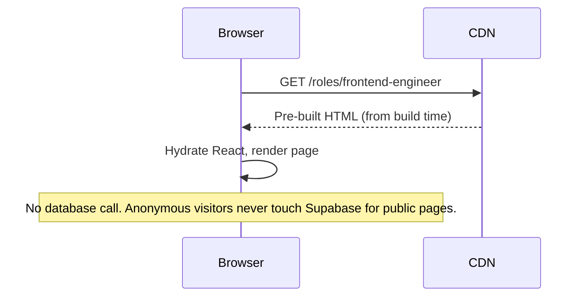
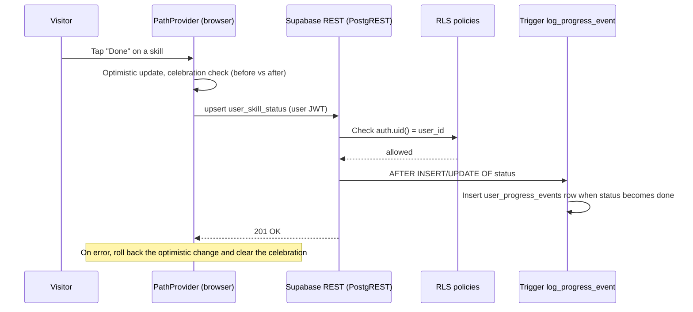
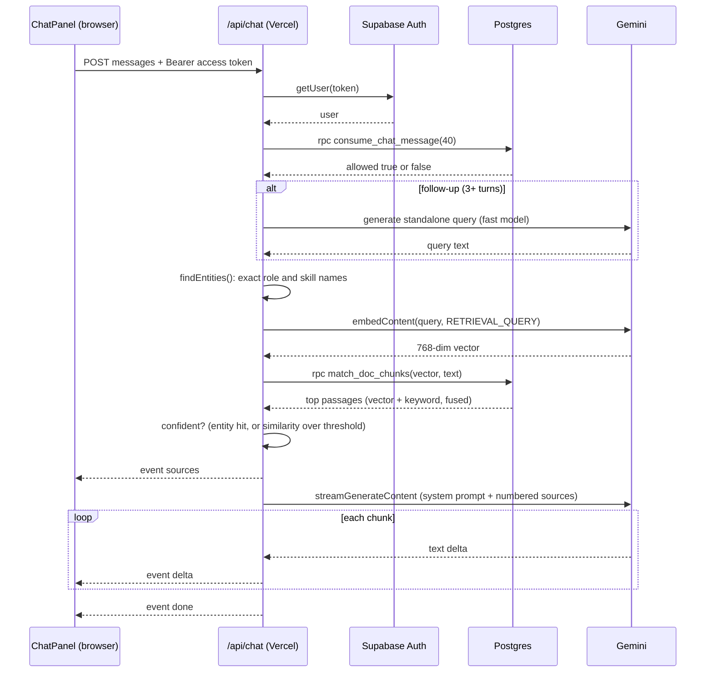
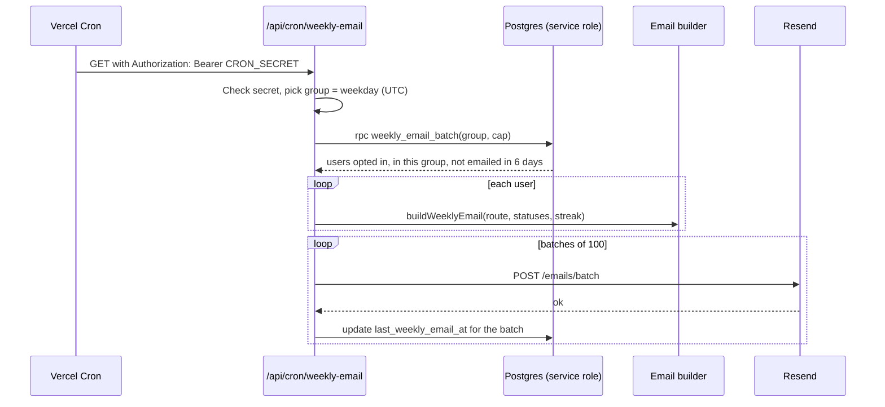
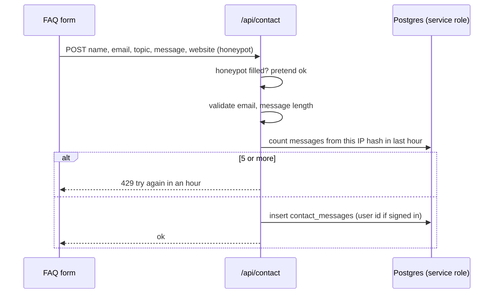
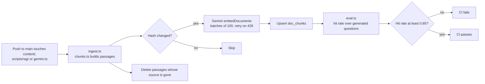

# System design: the whole of Code Journey

This file explains how the system fits together: the parts, who talks to whom, what each request does, what happens when something fails, and where it would strain. Read it once end to end, then use the [whiteboard version](#whiteboard-version-draw-this-in-two-minutes) to practise.

Diagrams use Mermaid. GitHub, VS Code (with a Mermaid extension) and most Markdown viewers render them.

---

## 1. The big picture

Three ideas explain most of the picture:

1. **Public content is files.** It is read from `content/` at build time and rendered to static HTML. No database is involved in showing a page.
2. **User data goes straight from the browser to Postgres.** The anon key identifies the project, and the user's login token identifies the person. Row-level security decides what they can read and write.
3. **Only the things that need secrets or heavy work run on a server.** The AI, the contact form, the email job and the admin dashboard use the service-role key or the Gemini key, and so they live in route handlers.

---

## 2. The components

| Component | Technology | Responsibility | Where it lives |
|---|---|---|---|
| **Content layer** | Markdown, YAML, JSON, Zod, gray-matter, `marked`, `shiki` | The site's data: roles, skills, blog, pay, quiz, glossary, FAQ | `content/`, `src/lib/content.ts` |
| **Static site** | Next.js 16 App Router, React 19, Tailwind 4 | Renders every public page at build time | `src/app/(site)/` |
| **Client state** | React context | `UIProvider` (panels, theme, chat), `PathProvider` (progress, bookmarks) | `src/components/shell/UIProvider.tsx`, `src/components/path/PathProvider.tsx` |
| **Route handlers** | Next.js route handlers on Vercel | Chat, contact, cron email, unsubscribe | `src/app/api/` |
| **Database** | Supabase Postgres 17 (per `config.toml`), RLS, pgvector, full-text | User state, progress log, AI index, usage counts, contact inbox | `supabase/migrations/` |
| **Auth** | Supabase Auth | Sign-up, sign-in, OAuth, sessions | Supabase project |
| **AI** | Gemini REST API via plain `fetch` | Embeddings for indexing and questions; streamed answers | `src/lib/gemini.ts` |
| **Retrieval** | SQL function `match_doc_chunks`, TypeScript `rag.ts` | Hybrid search and exact entity lookup | `supabase/migrations/20261007*`, `src/lib/rag.ts` |
| **Email** | Resend batch API | Weekly progress email | `src/lib/email/weekly.ts`, `src/app/api/cron/weekly-email/route.ts` |
| **Offline** | Service worker, web app manifest | Installable app, offline reading | `public/sw.js`, `src/app/manifest.ts` |
| **Admin** | Server components, server actions, `adminDb()` | Operations dashboard, login throttling | `src/app/(admin)/admin/`, `src/lib/admin.ts` |
| **Analytics** | GA4 with Consent Mode v2 | Anonymous page-view analytics where allowed | `src/components/shell/Consent.tsx` |
| **CI** | GitHub Actions | Weekly link check; index sync and retrieval evaluation | `.github/workflows/` |

---

## 3. How pages are produced

Notes for the whiteboard:

- **Build time, not request time.** Changing `content/` means rebuilding. This is why the weekly link check and CI matter.
- **Some routes read `content/` at runtime.** `/api/chat` and the cron route read files from disk on the server. Next.js is told to bundle `content/**` into those functions (`outputFileTracingIncludes` in `next.config.ts`). Without that, the functions would deploy without the files.
- **Pages with personal data are dynamic.** My Path, `/u/[handle]` and the admin dashboard are not in the static set.

---

## 4. Request flows

Each flow below shows what happens on one request, in order. Practise drawing two of them: the chat and the progress tick.

### 4.1 Opening a role page (anonymous)

### 4.2 Ticking a station (signed in)

### 4.3 Asking CJ AI a question

The browser keeps the stream open and writes each `delta` into the message. The `sources` event arrives before the answer, so the citations are ready when the text is.

### 4.4 Weekly progress email

### 4.5 Contact form

### 4.6 Admin sign-in and dashboard

- The login form calls a server action, `checkPassword`. It counts recent failures for the salted IP hash in `admin_login_failures`, compares the password in constant time, and on success sets an HttpOnly cookie signed with HMAC.
- Every dashboard action calls `requireAdmin()` first. The dashboard reads `admin_stats()` and `admin_users()` through `adminDb()`, which uses the service-role key on the server.

### 4.7 Indexing CJ AI (CI)

### 4.8 Offline reading

The service worker sees every same-origin request:

| Request | What the worker does |
|---|---|
| Page navigation | Network first. On failure, the saved copy, then `/offline` |
| `/_next/static/*` | Cache first (hashed file names never change) |
| Images, icons, fonts | Serve from cache, refresh in the background |
| `/me`, `/admin`, `/login`, `/u/`, `/email/`, `/api/` | Never stored. Offline navigation shows `/offline` |
| Supabase, GA, other origins | Not intercepted |

---

## 5. Who writes what

| Data | Written by | Via | Protected by |
|---|---|---|---|
| Content (roles, skills, pay, quiz) | Owner, through Git pull requests | Files in `content/` | Build checks (Zod, `check-content.ts`), review |
| User progress, route, bookmarks, votes, suggestions, projects | The signed-in user, from the browser | Supabase REST | RLS on every table |
| Profile and theme | The user, plus a trigger at sign-up | Supabase REST, `handle_new_user()` | RLS; the trigger is `security definer` |
| Progress event log | Database trigger only | `log_progress_event()` | No client write policy; `revoke` on the function |
| Chat usage counter | The server, on behalf of the user | `consume_chat_message()` RPC | `security definer`, granted to `authenticated` only |
| Chat feedback | The user, from the browser | Supabase REST | RLS insert and read own rows |
| AI index (`doc_chunks`) | CI or the owner's machine | `ingest.ts` with the service-role key | RLS on, no policies, so only the service role or the search function can read it |
| Contact messages | Anyone (rate limited) | `/api/contact` with the service-role key | RLS on, no policies |
| Admin login failures | Server | `checkPassword()` | RLS on, no policies |
| Weekly email status | The cron job | `weekly_email_batch()` and an update | Service role only |

The pattern to take away: **the browser writes only to tables where RLS limits it to its own rows, and every other write goes through the server, which holds the secret.**

---

## 6. Failure modes and how the system behaves

| Failure | What the visitor sees | Why it degrades this way |
|---|---|---|
| Supabase is down | Public pages work. Sign-in, progress and CJ AI show errors or do nothing. Progress changes roll back | Public pages never call the database |
| Gemini key is missing | CJ AI returns "not configured" (500) | Checked first in the route |
| Gemini embedding quota exhausted | CJ AI still answers, using keyword search only | The embedding call is wrapped in its own try and falls back to `null` |
| Gemini chat model overloaded (429, 500, 503) | Answer comes from the fast model | `streamAnswer()` retries once on the fallback before streaming starts |
| Gemini fails mid-stream | The message shows "CJ AI couldn't finish that answer" | An `error` event is sent, and the stream closes |
| Question not covered by the site | "Code Journey doesn't cover that yet", with the closest pages | No model call is made; the confidence check decides |
| Daily CJ AI limit reached | Message from the route: 40 questions today, resets at midnight UTC | `consume_chat_message` returns false |
| Resend fails for one batch | That batch is not marked sent, so the next day's run can retry it | The mark-sent update follows each successful batch |
| Contact database insert fails | "Couldn't send that. Please try again." | The insert result is checked |
| Service worker has a bug | Visitors can stay on an old version | `/sw.js` is `no-cache`; bump `VERSION` to replace caches |
| A content file is malformed | The build fails before deploy | Zod and `check-content.ts` run first |

---

## 7. Scaling and limits

The public site scales without thought: it is static files on a CDN. The interesting limits are in the dynamic parts.

| Part | What limits it | Rough headroom | What would break first |
|---|---|---|---|
| Public pages | CDN and build size | Very high | Build time as content grows, and the number of compare pairs |
| Reads of public content | None at runtime | Very high | Nothing |
| Progress writes | Postgres connections and RLS checks | High for a small team's scale | Connection count on a small Supabase plan under a traffic spike |
| Admin dashboard | `admin_stats()` aggregates over `auth.users` and events | Fine at thousands of users | Full-table counts as tables grow; add indexes or materialise |
| CJ AI | Daily quota (40 per user), Gemini quotas, three model round trips per question | Limited by Gemini quotas, not by the app | Embedding free tier (daily) and chat model rate limits |
| Vector search | HNSW index on 768-dim vectors over roughly 1,000 passages (914 at the last count in the notes) | Very high at this size | Only at much larger indexes |
| Weekly email | Resend plan (100 a day by default) and the seven-group split | 100 emails a day | Resend's daily quota |
| Contact form | Per-IP-hash limit, 5 an hour | Low by design | Spam from many networks |

**Latency of one CJ AI answer** is roughly: auth check, quota check, optional rewrite, one embedding call, one database search, then the stream. Three model calls and three to four database calls happen before the first token in the worst case (follow-up plus embedding). A quick win: validate the JWT locally instead of calling Supabase Auth, and skip the rewrite for short questions.

---

## 8. Design choices, in one line each

Each of these is explained in [11-decisions-and-history.md](11-decisions-and-history.md).

- **Static content from files**: no CMS, content gets review and history, and the build fails on bad content.
- **Browser talks to Postgres for user data**: fewer moving parts, and RLS is the single source of access control.
- **Service-role key only on the server**: a leak of the browser bundle cannot bypass RLS.
- **RAG, not fine-tuning**: content changes often, and answers need citations.
- **Hybrid search with fusion**: meaning and exact words both matter.
- **Exact entity lookup before search**: a direct question about a named skill always gets its page.
- **Optimistic UI with rollback**: the app feels instant and never shows a change that failed to save.
- **Event log for streaks**: an append-only record survives edits to the current state.
- **Milestones computed, not stored**: no drift between stored and real progress.
- **Browser-only job post checker**: no AI, no upload, so the privacy claim is simple to verify.
- **Weekly email in seven groups**: a steady, predictable send rate under a daily cap.
- **PWA with explicit caching rules**: offline works, and private data stays off shared devices.

---

## 9. Whiteboard version (draw this in two minutes)

Draw four boxes and three arrows, in this order:

1. **Browser** (React, a service worker, the Supabase client).
2. **Vercel** (static pages, and three route handlers: chat, contact, cron email).
3. **Supabase** (Auth, and Postgres with RLS and SQL functions).
4. **Gemini, Resend and GitHub Actions** as external services on the side.

Then say, in this order:

- "Pages are built from files, so most traffic never reaches a server."
- "Progress goes from the browser straight to Postgres, and RLS is the gatekeeper."
- "The chatbot is the one place where the server does real work: it embeds the question, searches the index, then streams a grounded answer."
- "Secrets only exist on the server. The browser has the public key, nothing more."

When asked for more detail, pick the chat flow (4.3), because it shows auth, quota, retrieval, generation and streaming in one picture.

---

## 10. Questions to ask yourself

1. What happens if two tabs tick different stations at the same moment? (Each upsert is for one `(user, skill)` row, so they do not clash. The optimistic state in one tab can briefly differ from the other until a reload.)
2. What happens if the Vercel cron runs twice in one day? (Each user is selected by group and by `last_weekly_email_at`, so the 6-day rule stops a second email.)
3. What stops someone editing another person's progress? (RLS policies with `auth.uid()`, plus the trigger that logs events, which only runs as the table owner.)
4. Where could the system lose data? (A failed write rolls back in the browser; a failed contact insert returns an error; a failed chat quota refund is not done, see [12-known-gaps-and-improvements.md](12-known-gaps-and-improvements.md).)
