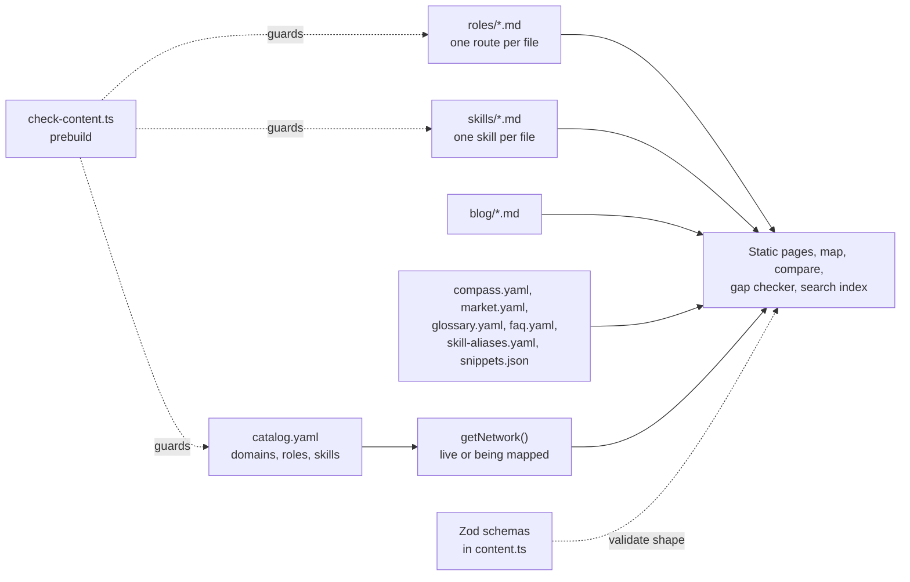

# Content and data model

Two kinds of data live in Code Journey, and they are kept apart on purpose:

1. **Content** (what the site teaches): roles, skills, pay, quiz, glossary, blog. It lives in files under `content/` and is never edited through a web form.
2. **User and operational data** (who is doing what): accounts, progress, votes, usage, messages. It lives in Postgres, with row-level security.

This file covers both: how content becomes pages, the shape of every content type, and every database table with its access rule.

---

## 1. Content is data, not components



**Why it matters.** Adding a skill or fixing a salary is an edit to a file, reviewed like code. There is no admin UI for content, no content database, and no runtime query to render a page. A typo fails the build rather than reaching production.

### Two layers of checking

| Layer | Checks | When it runs |
|---|---|---|
| **Zod** (`src/lib/content.ts`) | The shape of each file: required fields, types, enums, URLs, dates | Whenever content is loaded (build time, and in runtime routes) |
| **`scripts/check-content.ts`** | Relationships between files: unknown skill or role slugs, unknown prerequisites, missing catalog entries, duplicate resource URLs, Compass answers pointing at unknown roles, market rows that do not exist, unquoted commas in the catalog | `prebuild`, before every `npm run build`, and in the weekly link-check workflow |

Errors stop the build. Warnings print but do not. Examples of warnings: a skill with no official resource, or a role the Compass quiz can never suggest.

### Slugs

A **slug** is the lowercase, hyphenated name of a thing: `frontend-engineer`, `git`, `data-warehouses`. The file name is the slug (`content/roles/frontend-engineer.md`). Slugs appear in URLs, in cross-references and in the database.

**Slugs are permanent.** Users' saved progress stores skill and role slugs, and no foreign key links them to the content. Renaming a slug silently orphans that progress. The database enforces a format (`^[a-z0-9-]{2,60}$`), but not existence.

### Live versus being mapped

`catalog.yaml` lists every domain, role and skill. A catalog entry with no Markdown file is still drawn on the map, marked "being mapped". Adding the file makes it live. This is how the map could be drawn in full while the pages were still being written.

### Waves

Each role in the catalog has a `wave` number. Wave 1 roles are the launch set. The header uses them, so the most important roles are one click away.

---

## 2. The content types

Everything below is validated by Zod in `src/lib/content.ts`.

### Catalog (`content/catalog.yaml`)

| Entry | Fields |
|---|---|
| Domain (line) | `slug`, `code`, `name`, `line` (one of ten line styles), `tagline` |
| Role (destination) | `slug`, `title`, `domain`, `wave`, `oneLiner` (quote values with commas) |
| Skill (station) | `slug`, `title`, `domain` |

### Role (`content/roles/<slug>.md`)

Front matter holds the whole route. The Markdown body is optional extra text, rendered as an "in more depth" section.

| Field | Meaning |
|---|---|
| `title`, `aliases` | Display name, and other names used in search and the gap checker |
| `summary`, `whereTheyWork`, `dayInLife` | Plain-language description |
| `stages` (at least one) | Each has `name`, `summary`, `skills` (slugs in order), `project`, `doneWhen`, and optional `weeks` |
| `skills` | `must`, `should`, `nice`: slug lists by priority |
| `tools` | Free-text list |
| `interview` | `rounds`, and `practice` resources |
| `aiImpact` | How AI is changing the job |
| `market` | Notes, each with an optional source (title and URL) |
| `adjacent` | Related roles, used for compare pages and the AI index |
| `updated` | Date the role was last reviewed |

### Skill (`content/skills/<slug>.md`)

| Field | Meaning |
|---|---|
| `title`, `domain`, `level` | `beginner`, `intermediate` or `advanced` |
| `hours` | A range such as `"40–60"`, parsed for the hours-left estimate |
| `brief` | A one-minute explanation a beginner can follow |
| `prereqs` | Slugs that should come first (checked, and used for learning order) |
| `learn` | Topics, each with a detail line |
| `resources` (at least one) | Title, URL, provider, `type`, `cost` (free, freemium, paid), `official`, `note` |
| `checked` | Date the resources were last verified |

Resource types are `docs`, `book`, `course`, `video`, `interactive`, `practice`, `tool`, `article`, `community`. Resource URLs must be unique within a skill.

### Blog (`content/blog/<slug>.md`)

`title`, `date`, `tag`, `excerpt`, `readTime`, and a Markdown body with `##` headings.

### Compass (`content/compass.yaml`)

At least three questions. Each has an `id`, the question `q`, and at least two options. An option has a `label`, a `why` that completes "Because you...", and `weights` of 1 to 3 for each role it favours.

### Market (`content/market.yaml`)

Two source tables, one for India (PayScale: average, 10th and 90th percentile, entry pay, number of profiles, updated date, URL) and one for the US (BLS: median, projected growth, URL). A `roles` map links each role to a row in one or both tables, with `exact: false` when the match is the nearest published title. Unknown keys fail the build.

### Skill aliases (`content/skill-aliases.yaml`)

For each skill, the words the job post checker should recognise. A leading `=` makes a phrase case-sensitive (useful for "Go" versus "go"). A `not_covered` list names tools that appear in job posts but have no page yet.

### Other files

| File | Shape |
|---|---|
| `glossary.yaml` | `term`, `slug`, `category`, `definition` |
| `faq.yaml` | Groups of `{ q, a }` questions |
| `snippets.json` | `id`, `skill` (slug), `title`, `description`, `tags`, `code` |
| `changelog.yaml` | Dated versions with typed changes (`added`, `changed`, `fixed`, `removed`). Shown only in the admin dashboard |

---

## 3. What is derived, and from what

| Output | Derived from | Computed at |
|---|---|---|
| The map | Catalog, plus which files exist | Build time |
| Role page, stage list | Role file | Build time |
| Compare pages | Role files, pairs from `adjacent`, pay from `market.yaml` | Build time |
| Pay block and pay table | `market.yaml` | Build time |
| Job post checker data | Catalog, skill files (`level`, `hours`, `prereqs`, `resources`), aliases, roles | Build time (data), browser (matching) |
| Search index (`/search-index.json`) | Catalog and content | Build time |
| Path index (client route data) | Roles and skills | Build time, passed to the client as props |
| CJ AI passages | Roles, skills, glossary, FAQ, blog, pay | `ingest.ts`, run by CI or by hand |
| Weekly email content | Route file plus the user's statuses | At send time |
| Progress percentage, stage, next stations, hours left | Route file plus the user's statuses | In the browser |
| Milestones and celebrations | Route file plus the user's statuses | In the browser |
| Streak | The event log | In SQL, at query time |

---

## 4. The database

Nineteen migrations, in `supabase/migrations/`, applied in filename order. The first (`20261005000000_baseline.sql`) records the schema as it was on 2026-10-06, before migrations were tracked. The newest is `20261020000000_project_showcase.sql`.

### Tables

| Table | Purpose | Key columns | Who writes | Access rule |
|---|---|---|---|---|
| `profiles` | One row per user: name, theme and mode, public handle, email opt-in, email token, social links | `id` (references `auth.users`), `handle`, `public_name`, `path_public`, `weekly_email`, `email_token`, `theme`, `mode`, `github_url`, `linkedin_url`, `leetcode_url` | A trigger at sign-up; the user, from the browser | RLS: own row only, `for all to authenticated` |
| `user_paths` | The one destination a user is working towards | `user_id` (primary key), `role_slug`, `started_at`, `updated_at` | The user | RLS: own row |
| `user_skill_status` | Status per skill. A row exists only for started skills; no row means "to do" | `(user_id, skill_slug)` primary key, `status` (`learning` or `done`) | The user | RLS: own rows |
| `user_progress_events` | Append-only log: one row each time a skill becomes done. Feeds streaks | `user_id`, `skill_slug`, `created_at` | A trigger only | RLS: select own. No write policy |
| `user_saved_resources` | Bookmarks, keyed by URL | `(user_id, url)` primary key, `title` snapshot, `skill_slug` | The user | RLS: own rows |
| `resource_votes` | "Was this helpful?" per resource | `(user_id, url)` primary key, `vote` (`1` or `-1`), `skill_slug` | The user | RLS: own rows. Helpful counts are public through `resource_helpful_counts()` |
| `resource_suggestions` | "Know a better resource?" submissions for review | `skill_slug`, `url`, `title`, `note`, `status` (`new`, `accepted`, `declined`) | The user, at most 5 a day (trigger) | RLS: insert and select own |
| `user_projects` | One project per route stage, with an https link | `(user_id, role_slug, stage_name)` unique, `title`, `url` | The user | RLS: own rows |
| `doc_chunks` | The CJ AI index: passages with a 768-dimension embedding and a full-text vector | `key` (unique), `source_type`, `url`, `title`, `heading`, `content`, `content_hash`, `embedding`, `tsv` | `ingest.ts` (service role) | RLS on, no policies. Read only through `match_doc_chunks()` |
| `chat_usage` | Messages per user per day | `(user_id, day)` primary key, `messages` | `consume_chat_message()` | RLS: select own |
| `chat_feedback` | Thumbs up or down on answers, with the question, answer and sources shown | `rating` (`1` or `-1`), `comment`, `sources` | The user | RLS: insert and select own |
| `contact_messages` | The FAQ contact form inbox | `name`, `email`, `topic`, `message`, `page`, `ip_hash`, `status` | `/api/contact` (service role) | RLS on, no policies |
| `admin_login_failures` | Failed admin sign-ins, for throttling | `ip_hash`, `created_at` | Server only | RLS on, no policies |
| `notes`, `tasks`, `activity_logs` | Leftovers from the original app, in the baseline. Policies exist, and nothing in the current code appears to use them | | | RLS: own rows |

### Functions

| Function | Kind | What it does |
|---|---|---|
| `handle_new_user()` | Trigger on `auth.users` insert | Creates the `profiles` row, with the name and email from sign-up |
| `log_progress_event()` | Trigger on `user_skill_status` | Writes a `user_progress_events` row when a status becomes `done` |
| `streak_weeks(user)` | SQL, `security definer` | Counts consecutive active weeks (see [08-my-path-and-progress.md](08-my-path-and-progress.md)) |
| `my_streak()` | RPC for the signed-in user | Returns the streak and whether this week counts |
| `get_public_path(handle)` | RPC, public | Returns the public page data, and nothing private |
| `handle_available(handle)` | RPC | Checks whether a handle is free |
| `weekly_email_batch(group, limit)` | RPC, service role only | Picks the users to email today |
| `unsubscribe_weekly_email(token)` | RPC | Turns off the email for the token's owner |
| `resource_helpful_counts(urls)` | RPC, public | Helpful counts for a list of URLs (up to 500) |
| `consume_chat_message(limit)` | RPC, signed in only | Adds one to today's count and returns whether it is within the limit |
| `match_doc_chunks(vector, text, count)` | RPC, public | Hybrid search over `doc_chunks` |
| `admin_stats()` and `admin_users(...)` | RPC, service role only | The admin dashboard's data |
| `limit_resource_suggestions()` | Trigger | Rejects a sixth suggestion in a day |

### Indexes worth naming

- `doc_chunks`: an HNSW index on `embedding` (cosine), and a GIN index on `tsv`.
- `user_progress_events (user_id, created_at desc)`: for streak queries.
- `user_skill_status (user_id, updated_at desc)`: for the public path and the weekly email.
- `resource_votes (url) where vote = 1`: a partial index for helpful counts.
- Indexes on `ip_hash` and `created_at` for the rate limits.

### The RLS pattern

Every user table follows the same shape. Copy it exactly when adding a table:

```sql
alter table public.my_table enable row level security;

create policy "Users manage own my_table" on public.my_table
  for all to authenticated
  using ((select auth.uid()) = user_id)
  with check ((select auth.uid()) = user_id);
```

Three details matter. `to authenticated` means anonymous visitors match no policy. The `select` wrapper makes Postgres evaluate `auth.uid()` once per statement. `with check` stops a user from inserting or updating a row to someone else's `user_id`.

### Security definer and search path

Functions that need to bypass RLS (`handle_new_user`, `get_public_path`, `streak_weeks`) are `security definer`, and they set a fixed `search_path`. Functions for the server only are revoked from `public`, `anon` and `authenticated`, then granted to `service_role`. The details are in [07-security-and-privacy.md](07-security-and-privacy.md).

---

## 5. How the data changes over time

- **Migrations are additive.** Each file is re-runnable (`create table if not exists`, `add column if not exists`, `create or replace function`), and an applied file is never edited.
- **Functions are redefined.** `get_public_path()` appears in five migrations, each adding a field. Only the last one counts. This is a known maintainability cost (see [12-known-gaps-and-improvements.md](12-known-gaps-and-improvements.md)).
- **Constraints carry rules.** Examples: the GitHub URL must match a GitHub profile pattern; the LinkedIn URL must be `/in/` or `/company/`; the project URL must be https; a theme must be one of the four ids.
- **New themes need a migration.** The `profiles.theme` check constraint lists the four ids, so adding a theme means updating the constraint too (the developer guide has the recipe).

---

## 6. Practice exercise

1. Open `content/roles/frontend-engineer.md` and `src/lib/content.ts` side by side. For each front-matter field, find the place where it is validated and the place where it is rendered.
2. Add a fake skill slug to one stage in a role file, then run `npm run content:check`. Read the error, then remove the slug.
3. In the Supabase dashboard (or `supabase/migrations/`), find the policy that protects `user_saved_resources`, and say in one sentence what a logged-out visitor can do with that table.
