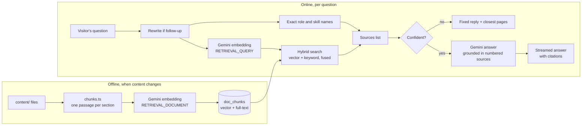
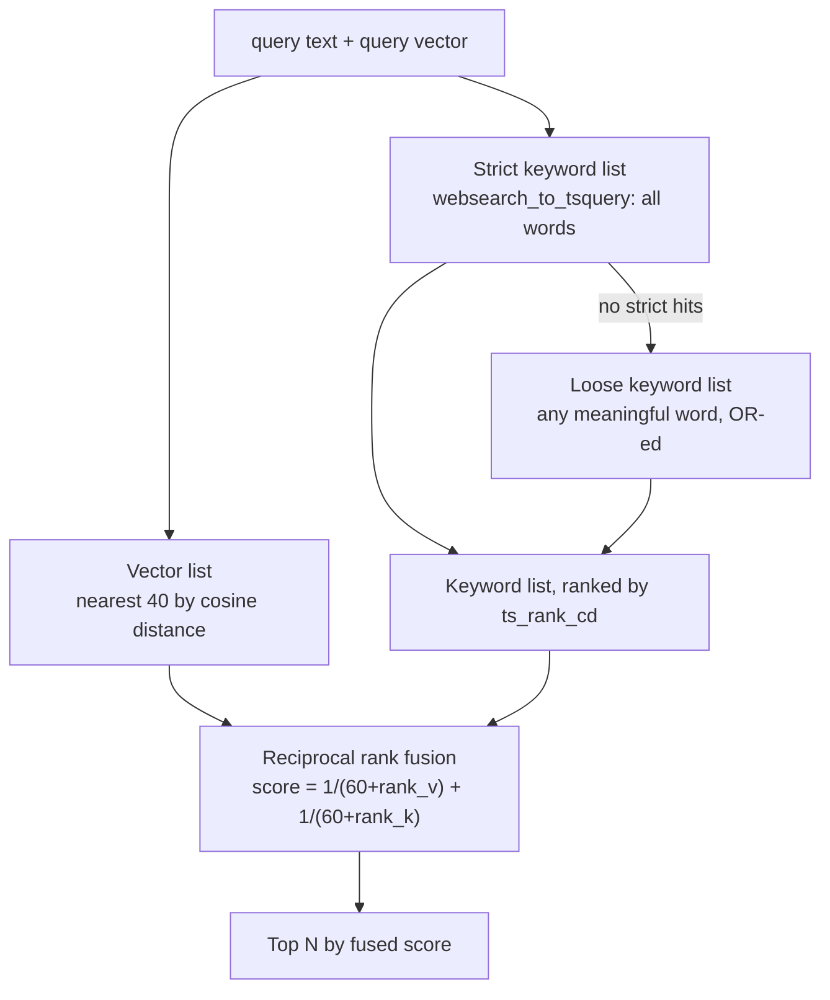

# CJ AI: retrieval-augmented chat, end to end

CJ AI is the chatbot on every page of Code Journey. It answers questions about tech careers, using only the site's own content, and it cites the pages it used. This file explains how it works from the content files to the streamed answer, the design decisions behind it, its limits, and how its quality is measured.

If you only remember one sentence: **the model never searches; the server searches first, then the model writes an answer from the passages the server found, and is told to say "I don't know" when they don't cover the question.**

---

## 1. The idea in one picture



The rest of this file walks through each box.

---

## 2. Indexing: from content to passages

### 2.1 Chunking

`scripts/rag/chunks.ts` turns content into **passages**. A passage is the unit the search returns, so its size decides how precise the answer can be.

| Source | Passages made | Example key |
|---|---|---|
| Each role | One overview, one per stage, one for skills by priority, one for interviews, one for the market and AI impact, one for pay, plus one per Markdown `##` section | `role:frontend-engineer#stage-2` |
| Each skill | The brief, what to learn, the resources, each extra Markdown section, and a "roles that need it" passage | `skill:git#brief` |
| Glossary terms | One per term | `term:<slug>` |
| FAQ, blog, domains | One per question, one per blog section, one per field of tech | `faq:<question>`, `post:<slug>#<heading>`, `domain:<slug>` |
| Pay | One per role, inside its role | `role:...#pay` |

Each passage has:

- **`key`**: a stable identifier such as `role:frontend-engineer#stage-2`, so re-indexing can update it in place.
- **`title`** and **`heading`**: the page and the section.
- **`content`**: the text the model will read. It starts with the title and heading, for example `Frontend Engineer (career route) - Stage 2 of 4: Core`, so a passage makes sense when it is read alone.
- **`url`**: the page it links to, with an anchor where one exists.
- **`content_hash`**: a short SHA-256 of the content. If it has not changed, the passage is not re-embedded.

### 2.2 Embedding and storage

`scripts/rag/ingest.ts` does the following:

1. Load every existing `key` and `content_hash` from `doc_chunks`.
2. Work out which passages are new or changed, and which keys no longer exist.
3. Embed only the new or changed passages, 100 at a time, with `gemini-embedding-2` at **768 dimensions** and the task type **`RETRIEVAL_DOCUMENT`**.
4. Upsert the rows by `key`, then delete the stale ones.

It retries rate-limit errors (429) and server errors with exponential backoff, up to about a minute between tries, because the free embedding quota is counted per minute and per day.

The `doc_chunks` table has:

- `embedding vector(768)` with an **HNSW** index using cosine distance;
- `tsv`, a generated `tsvector` built from the title (weight A), the heading (weight B) and the content (weight C), with a GIN index.

The table has row-level security enabled and **no policies**, so the browser cannot read it directly. It is read only through the search function, which is `security definer`.

### 2.3 Running it

```bash
npm run rag:ingest      # embed what changed
npm run rag:eval        # measure retrieval quality
npm run rag:ask         # ask a question from the terminal
```

CI runs ingest and evaluation on every push to `main` that touches `content/`, `scripts/rag/` or `src/lib/gemini.ts` (`.github/workflows/cj-ai-index.yml`).

---

## 3. Answering: the request, step by step

The route is `src/app/api/chat/route.ts`. Read it alongside this list.

| Step | What happens | Why |
|---|---|---|
| 1. **Who is asking?** | The browser sends the user's login token as a Bearer header. The server calls `auth.getUser()`. No token or no user returns 401 | Only signed-in users may ask, which makes the daily quota meaningful |
| 2. **Validate input** | Keep the last 12 turns, cut each message to 2000 characters, and require the last message to be from the user | Caps cost and stops abuse |
| 3. **Quota** | `consume_chat_message(40)` adds one to today's count for the user, atomically, and returns whether it is within the limit | Atomic in one statement, so two tabs cannot both slip under the limit |
| 4. **Rewrite a follow-up** | If there are three or more turns, the fast model rewrites the last message as a standalone query, using the last few turns as context | "What about interviews?" means nothing alone, so it is rewritten to "What are the interview rounds for frontend engineers?" |
| 5. **Exact entities** | `findEntities()` looks for role and skill names and their aliases in the query and the question. Up to two hits, longest match first, roles first | Vector search can miss a direct question. Named pages are added as sources before any search |
| 6. **Embed the query** | `embedQuery()` with task type `RETRIEVAL_QUERY`. If it fails, the search runs without a vector | Keeps answering when the embedding quota is gone |
| 7. **Hybrid search** | `match_doc_chunks(vector, text, 10)` returns the best passages, combined from vector ranking and keyword ranking | Meaning and exact words both matter (see section 4) |
| 8. **Confidence** | Confident if an exact entity was named, or the top vector similarity is at least `CJ_MIN_SIMILARITY` (0.55 by default). Without a vector, any keyword hit counts | Decides whether the model is allowed to answer at all |
| 9. **Stream** | Send a `sources` event with the numbered list. If confident, stream the model's answer. If not, send a fixed sentence, plus up to three closest pages | The citations appear before the text, and no model call is made when the answer is not in the content |

### The stream

The response is `text/event-stream`. Each event is `event: <name>` and `data: <JSON>`, separated by a blank line.

| Event | Data | Sent when |
|---|---|---|
| `sources` | `[{ n, title, heading, url }]` | Once, before any text |
| `delta` | A string of text | Once per chunk from the model |
| `done` | `{}` | The answer is complete |
| `error` | `{ message }` | Generation failed. The message is friendly, never a stack trace |

The browser (`readEvents()` in `ChatPanel.tsx`) reads the body with a reader, splits on blank lines, and appends each `delta` to the message. A stop button aborts the request. The server sees the closed connection through `req.signal`, which is passed on to the model call.

### The prompt

The model receives:

1. A **system prompt** (`src/lib/rag-prompt.ts`) that says what CJ AI is, that it must answer only from the numbered sources, that it must cite inline like `[1][2]`, that it must say "Code Journey doesn't cover that yet" when the sources do not answer, that it must not invent URLs, numbers or salaries, and that it should reply in the user's language.
2. The conversation history (minus the last message), so follow-ups make sense.
3. A final user turn with the sources, formatted as `[n] Title - Heading`, then `Page: /url`, then the passage text, and then the question.

The model is called with temperature 0.3, a maximum of 1200 output tokens, and a low thinking level, which the 3.x models need to respond reliably.

---

## 4. Hybrid search, explained

The SQL function `match_doc_chunks` runs three ranked lists and fuses them.



**Vector search** finds passages whose meaning is close to the question, even with no shared words. "A job that keeps websites running at 3am" finds the SRE role.

**Keyword search** finds exact terms. Its strict form needs all the words. If that finds nothing, a looser form accepts any meaningful word. A list of stop words ("the", "what", "job", "role") is removed first, so a question about "jobs" does not match every page.

**Fusion** uses reciprocal rank fusion. A passage gets `1/(60 + rank)` from each list it appears in, and the scores are added. Ranks are used rather than raw scores, so the two lists do not need comparable scales. The constant 60 comes from the original RRF paper and stops the very top ranks from dominating. A passage found by both methods rises to the top.

**Keyword only.** When there is no vector, the function still works, and `similarity` is returned as null. This is the fallback when the embedding quota is exhausted.

The function's history shows the path: first vector search only, then keyword fallback, then "any word" matching, then weighted columns (title above heading above body). Each step is a migration in `supabase/migrations/20261007*`.

---

## 5. Grounding: how the answer is kept honest

There are four layers, and each one can fail on its own.

1. **Retrieval gate.** If nothing is confident, the model is never called. The fixed reply says "Code Journey doesn't cover that yet" and lists the closest pages.
2. **System prompt.** Answer only from the numbered sources. Cite them. Do not use general knowledge. Do not invent links or numbers.
3. **Source restriction.** Only passages from the site are in the index, so the sources cannot contain outside facts.
4. **Evaluation.** Retrieval quality is measured in CI (section 7), so a content or code change that breaks retrieval is caught.

What is **not** checked: the code does not verify that the model's citations point to the sources it was given, or that its links appear in the sources. A stronger version would parse `[n]` markers and drop answers that cite nothing.

---

## 6. Limits and cost control

| Control | Value | Where |
|---|---|---|
| Signed-in users only | Bearer token required | `route.ts` step 1 |
| Daily messages per user | 40 (`CJ_DAILY_LIMIT`), resets at midnight UTC | `consume_chat_message` |
| History kept | Last 12 turns | `MAX_TURNS` |
| Message length | 2000 characters | `MAX_CHARS` |
| Sources sent to the model | At most 7 (`MAX_SOURCES`) | `route.ts` |
| Search results fetched | 10 | `match_count` |
| Output length | 1200 tokens | `streamAnswer()` |
| Temperature | 0.3 | `streamAnswer()` |
| Model calls per question | 1 to 3 (rewrite, embed, generate) | |
| Fallback model | `gemini-flash-lite-latest` on 429, 500 or 503 before the stream starts | `streamAnswer()` |
| Function timeout | 30 seconds | `maxDuration` |
| Embedding quota | Free tier: a daily cap. Index build and evaluation can hit it | Gemini console |

Model names are environment variables (`GEMINI_MODEL`, `GEMINI_FAST_MODEL`, `GEMINI_EMBED_MODEL`), because the model families change. Notes at the top of `gemini.ts` record the history: the 2.5 models were closed to new API keys, and the 3.x models need a low thinking level or they return 503.

**A known weakness:** the quota is taken before retrieval. If retrieval then fails, the visitor has lost a message and gets an error. A refund on failure would fix it (see [12-known-gaps-and-improvements.md](12-known-gaps-and-improvements.md)).

---

## 7. Measuring quality

`scripts/rag/eval.ts` answers one question: **when someone asks about a thing, does the right page come back near the top?**

| Test set | How it is built | Count |
|---|---|---|
| Roles | Two questions per role: "What does a X do day to day?" and "How long does it take to become a X?" | 2 per role |
| Skills | "What are the best resources to learn X?" | 1 per skill |
| Glossary | "What is X?" (expects the glossary page or a skill page) | 1 per term |
| Paraphrases | Hand-written questions that never name the role or skill, such as "which job keeps websites online at 3am" | 20 |
| Off-topic | Questions like "What is the capital of Australia?" | 8 |

For each question, the script records whether an expected URL is in the top results, and the top similarity. The **hit rate** is the share of questions with a hit. CI fails below **0.85** (`--min-hit 0.85`). The off-topic similarities show where the confidence threshold should sit: the threshold should be above the off-topic scores and below the on-topic ones.

**Open item (from the owner's notes):** `CJ_MIN_SIMILARITY` has not been calibrated from real evaluation numbers. Doing that is the next quality task.

---

## 8. Feedback and the team's view

- Each answer has thumbs up and down. The row goes to `chat_feedback` with the question, the answer (up to 8000 characters) and the source URLs, so a bad answer can be traced to what the model saw.
- The admin dashboard shows the totals, the last 30 days, the number of passages in the index and when it was last updated.

---

## 9. Design decisions, with the reasons

| Decision | Reason | Trade-off |
|---|---|---|
| **RAG, not fine-tuning** | Content changes often. Citations need real passages. An edit takes effect after re-indexing, not a training run | Retrieval quality becomes the main thing to measure |
| **Passages by section, with a title prefix** | Small enough to be precise, and each passage stands alone | A question spanning two sections may need two passages |
| **Hybrid search with fusion** | Paraphrases and exact jargon both matter | Two queries per question, inside one SQL function |
| **Exact entity lookup** | Direct questions about a named skill always get its page | Relies on the alias list; a missing alias means no exact hit |
| **Confidence gate before generation** | The model cannot answer from general knowledge if the gate says no | A good question with poor retrieval gets the "doesn't cover that" reply |
| **Gemini over plain REST** | No SDK dependency, easy to swap the URL, and easy to run in scripts and in the Next.js server | We write the streaming parser ourselves (about 30 lines) |
| **Quota in the database** | Atomic, shared across tabs and servers, and visible in the dashboard | One extra database round trip per question |
| **Retrieval open to anon, generation gated** | The search returns public content only. The gate that costs money is the model call | Anyone can call the search function with a keyword query, which costs nothing and returns public passages |
| **History from the browser** | No server-side chat table needed | The server cannot prove what a user said earlier, but sources always come from the database |

---

## 10. Practice: explain it to an interviewer in four minutes

1. Start with the sentence in the opening of this file.
2. Draw the offline box (content, chunks, embeddings, table) and the online box (question, search, gate, model, stream).
3. Explain fusion with a worked example: a passage ranked 2nd by vectors and 5th by keywords scores `1/62 + 1/65`, which beats a passage ranked 1st by vectors and absent from keywords (`1/61`).
4. Name the four grounding layers and say which one you would strengthen first (citation checking).
5. Name the three numbers you would tune first: the similarity threshold, the number of sources, and the daily limit.

For more questions, see the AI section of [02-interview-qa-bank.md](02-interview-qa-bank.md).

---

## 11. Files to read, in order

1. `scripts/rag/chunks.ts` (how passages are made)
2. `scripts/rag/ingest.ts` (how they are stored)
3. `supabase/migrations/20261007000000_cj_ai_rag.sql`, then the three later migrations in `20261007*` (the search function, step by step)
4. `src/lib/rag.ts` (exact entity lookup and the source formatting)
5. `src/lib/rag-prompt.ts` (the system prompt)
6. `src/lib/gemini.ts` (the REST client, streaming, fallback)
7. `src/app/api/chat/route.ts` (the orchestration)
8. `src/components/shell/ChatPanel.tsx` (the streaming client)
9. `scripts/rag/eval.ts` (how quality is measured)
