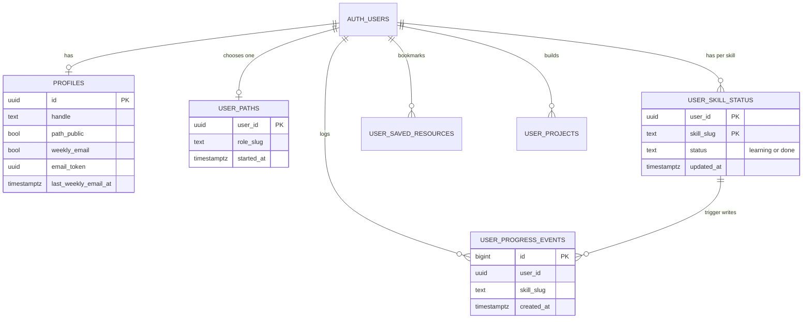
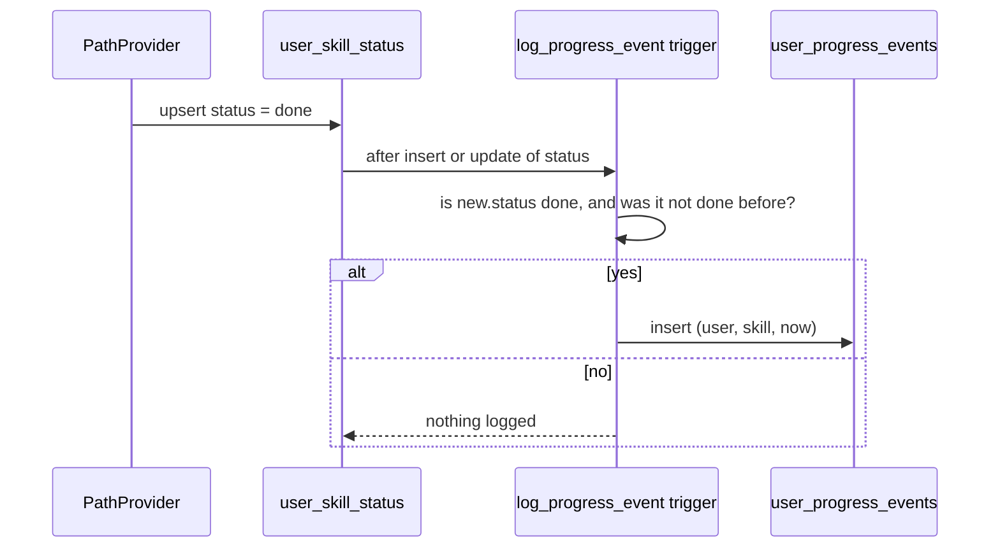

# My Path: progress, milestones, streaks and the weekly email

My Path is the signed-in part of Code Journey. A person picks a destination (a role), ticks off the stations (skills) as they learn them, and sees their progress, milestones and streak. This file explains the data, the maths, the client behaviour, the SQL that counts weeks, and the email that brings people back.

Read it with these files open: `src/lib/path.ts`, `src/lib/milestones.ts`, `src/components/path/PathProvider.tsx`, and `supabase/migrations/20261011000000_streaks.sql`.

---

## 1. The data



The design choice to notice: **the database stores choices and a log, and the application computes everything else.** There is no stored percentage, no stored streak count and no stored milestone. Each is derived from the route file and the statuses, so none of them can drift out of date.

- **No row means "to do".** A `user_skill_status` row exists only for skills the person has started. This keeps the table small and makes "to do" the default.
- **Statuses are only `learning` and `done`.** A skill with no row is "to do".
- **Progress events are append-only.** A row is added each time a skill becomes `done`, and never removed. Editing a skill that is already done does not add a second event.

---

## 2. Progress maths

`computeProgress(index, roleSlug, statuses)` in `src/lib/path.ts` takes the route data and the person's statuses, and returns:

| Output | How it is computed |
|---|---|
| `skills` | Every skill in the route, in order, with duplicates removed (a skill can appear in two stages) |
| `done`, `learning`, `total` | Counts over `skills` |
| `percent` | `done / total`, rounded |
| `stages` | Each stage with its own `done`, `total` and `percent` |
| `currentStage` | The first stage that is not fully done. If everything is done, the last stage |
| `next` | The first four skills not yet done, in route order |
| `hoursLeft` | A low-and-high range: the sum of the low and high hour estimates of the skills not yet done |

Hours come from each skill file's `hours` field, such as `"40–60"`. `parseHours()` reads the first and last numbers, so a single value like `"10"` becomes a range of 10 to 10.

`formatWeeks()` turns hours into calendar time at **10 hours a week**. If the upper estimate is under about six weeks, it reads in weeks; otherwise in months (about 4.345 weeks to a month). The 10-hour pace is an assumption, and the UI says so.

**Why ranges?** Hours per skill are estimates. Adding them as a single number would look more precise than the data is. A range of "480–640 hours" says what the data supports.

---

## 3. Milestones and celebrations

`milestones(progress)` returns the list in route order:

1. **First station**: at least one skill done.
2. **Stage complete**: one per stage, when every skill in it is done.
3. **Halfway**: placed after the stage that takes the cumulative count past half the route, so it appears in the right place in the list.
4. **Route complete**: when the percentage is 100.

`celebrationFor(route, before, after, skill)` answers "did this one tick just finish something?"

- It returns nothing if the skill is not on the route.
- It returns a **route** celebration if every skill on the route is done now and was not before.
- Otherwise it returns a **stage** celebration if the skill's stage became complete with this tick, and it names the next stage.

The key idea is **before versus after**. A celebration only happens on the transition from incomplete to complete, so re-ticking a finished station never celebrates again, and un-ticking and re-ticking does celebrate again, which is correct because the stage was incomplete in between.

---

## 4. The client: `PathProvider`

`PathProvider` is a React context. It loads the signed-in person's data once, and exposes these functions:

| Function | What it does |
|---|---|
| `setRole(slug)` | Upserts `user_paths`, or deletes the row to clear the route |
| `setStatus(skill, status)` | Upserts `user_skill_status`, or deletes the row for "to do" |
| `toggleSaved(resource)` | Adds or removes a bookmark |

### Optimistic updates with rollback

Every write follows the same pattern:

```text
1. Save the current state as "previous"
2. Update the state immediately (the UI feels instant)
3. Send the write to Supabase
4. If it fails, put "previous" back
```

For `setStatus`, the celebration is computed before the write, then cleared if the write fails. This means the toast only appears when the change is real.

**Known rough edge.** The rollback uses the state the function was created with. If two ticks happen quickly, the second rollback can restore a state that does not include the first tick. For a single user on one device this is rarely visible. A reducer with a queue of pending writes would fix it, and is a good improvement to describe.

### Why the browser writes directly

The browser sends the write to the Supabase REST API with the user's token. RLS checks the row. There is no API route in between, so there is no extra code to keep in step with the database. The cost is that the database rules must be right, which is why [07-security-and-privacy.md](07-security-and-privacy.md) has so much on RLS.

### Server-side data for the client

`getPathIndex()` (in `content.ts`) builds a small object with the roles (slug, title, domain, stages with skill lists and weeks) and the skills (title, hours, whether live). The site layout passes a trimmed copy of the routes (slug, title and stages) to `PathProvider`, and My Path receives the full index as a prop. The client never reads files, and the object is small enough to send on every page.

---

## 5. Streaks, in SQL

A streak is the number of **consecutive weeks** with at least one station ticked. A week is Monday to Sunday in UTC. The count is done in SQL, in `streak_weeks(user)`.

### The steps

1. **Collect the active weeks.** `date_trunc('week', created_at)` gives the Monday of each event's week. `distinct` gives one row per active week. Only the last three years are considered.
2. **Choose an anchor.** The anchor is this week's Monday if this week has activity. If not, it is last week's Monday. This is the grace rule: a streak stays alive until the current week ends, and a week that has not started yet cannot break it.
3. **Keep the weeks at or before the anchor.**
4. **Number the weeks.** `k = (anchor - week) / 7` is how many weeks back each week is. `rn` is its position in descending order, starting at 0. For a run of consecutive weeks ending at the anchor, `k` equals `rn` for each one.
5. **Count the matches.** `count(*) where k = rn`.

### Why counting matches gives the streak

Weeks are distinct and sorted newest first, so `k` (weeks back) is always at least `rn` (position in the list). The two are equal only while there is no gap. The first gap makes `k` larger than `rn` for that week and for every older week after it, so they never match again. The count of matches is therefore exactly the length of the unbroken run from the anchor.

### A worked example

Suppose the anchor is week 0 (this week), and the active weeks are: this week, last week, and two weeks ago, and then a gap, and a week four weeks ago.

| Week | Weeks back (`k`) | Position (`rn`) | `k = rn`? |
|---|---|---|---|
| This week | 0 | 0 | yes |
| Last week | 1 | 1 | yes |
| Two weeks ago | 2 | 2 | yes |
| Four weeks ago | 4 | 3 | no, and never again |

The streak is 3.

### The other functions

| Function | Returns | Used by |
|---|---|---|
| `streak_weeks(user)` | The number | My Path, the public page, the weekly email, the admin dashboard |
| `my_streak()` | `{ weeks, this_week }` for the signed-in user | My Path (`this_week` shows whether the current week already counts) |

---

## 6. The event log and its trigger



Why a trigger and not application code:

- **It cannot be forgotten.** Every path that marks a skill done, including future ones, writes the event.
- **It is in the same transaction** as the status change, so the log and the status cannot disagree.
- **It respects the rule "only a new completion counts".** The check `old.status is distinct from 'done'` stops editing a finished skill from creating a second event.

The migration also backfilled the log from existing `done` rows, so people who finished skills before the log existed keep their streak.

---

## 7. Public path page (`/u/handle`)

The page is built by `get_public_path(handle)`, which returns only what the person chose to show:

- handle, public name (or the handle), the role, the start date and the last-updated date
- the statuses for each skill
- the streak
- the projects for the current route
- the GitHub, LinkedIn and LeetCode links, if set

It is only returned when `path_public` is true. It never returns the email, the user ID or the token. The page is `noindex`, and it has a generated share image. The handle is checked for availability with `handle_available()` while the person chooses it.

---

## 8. The weekly email

### Who gets it

People who meet all of these conditions:

- `weekly_email` is true (opt-in);
- their email is confirmed;
- they have chosen a route (the email is about a route);
- they were not emailed in the last six days;
- their user ID falls in today's group.

### How the seven groups work

`mod(abs(hashtext(user_id)), 7)` puts each user into one of seven stable groups. The cron runs every day, and uses the day of the week (UTC) as the group number. Each user is therefore visited once every seven days, on the same weekday, and the six-day rule stops a second email if a run is retried.

The schedule is in `vercel.json`: `30 3 * * *`, which is 03:30 UTC daily.

### What it says

`buildWeeklyEmail()` writes a subject, an HTML version and a text version. The subject changes when the route is finished. The content is:

- what was ticked this week (only skills on the person's route),
- the current stage and the next stations,
- the hours left, as a range,
- the streak,
- a link to My Path and to the route,
- an unsubscribe link.

The builder is a pure function with no network calls, so it can be previewed with `?dry=1` on the cron route, which builds the emails and sends nothing.

### How it is sent

Messages go to Resend's batch endpoint, 100 at a time. A batch is marked as sent in the database only after Resend accepts it. A failed batch is not marked, so the next run can retry it. The daily cap (`WEEKLY_EMAIL_DAILY_CAP`, 100 by default) matches the free plan.

### Unsubscribing

Every email has a link with the person's random `email_token`, and a `List-Unsubscribe` header with one-click support. Visiting the link calls `unsubscribe_weekly_email(token)`, which turns off the email for the owner of that token. No login is needed.

---

## 9. What is hard here, and what to say about it

- **Week boundaries** are UTC, not the visitor's time zone. A student in India who studies on Sunday evening local time may see the streak end at a different moment. The fix would be a per-user time zone, which is a small change to the streak function.
- **Milestones are computed, not stored**, so they are always right, but a milestone reached and then undone is not remembered. That is the intended trade-off.
- **The hours estimate is a guess from the content.** It is shown as a range and labelled as an assumption.
- **The weekly email runs in seven groups.** Each person gets at most one email a week, always on the same weekday, because their group is fixed by their ID. The six-day rule stops a retry from sending a second one.

---

## 10. Practice

1. Open `computeProgress()` and trace what happens when a skill appears in two stages. Count how many times it is in `skills`.
2. Use the streak example above, and change the anchor to last week. Work out the count.
3. Explain why `celebrationFor()` takes both `before` and `after` instead of only the new state.
4. In the Supabase SQL editor (or by reading the migration), explain why the streak function's `numbered` CTE uses `row_number() over (order by w desc) - 1`.
