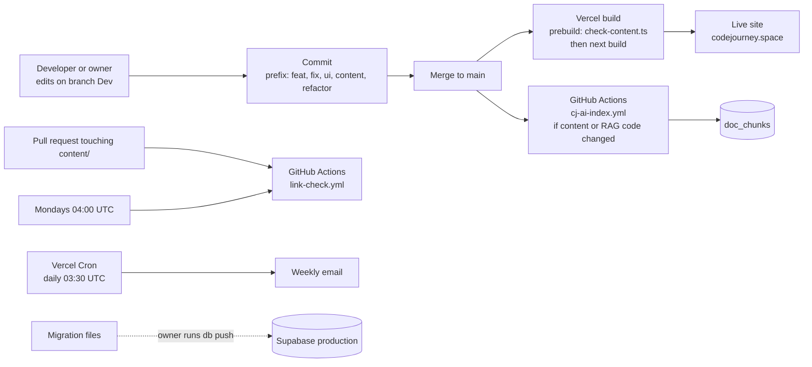

# Delivery, CI and operations

How code and content get from a developer's machine to the live site, what checks run on the way, what runs on a schedule, how database changes ship, and what to do when something breaks.

---

## 1. The path from change to production



Notes:

- **Work happens on the `Dev` branch. `main` is the release branch.** The owner merges to `main`. The developer guide says to ask before introducing a different flow.
- **Vercel builds on each push**, so `main` is what goes live.
- **Database changes do not deploy with the code.** They are applied by hand with `supabase db push`, by the owner. This separation is deliberate: a bad schema change cannot ship by accident.

---

## 2. Quality gates

There are no automated tests. These are the checks that exist, and where each one runs.

| Gate | What it checks | Runs on | Failure means |
|---|---|---|---|
| **`prebuild`: `scripts/check-content.ts`** | Relationships between content files (see [05-content-and-data-model.md](05-content-and-data-model.md)) | Every `npm run build`, every Vercel build, the link-check workflow | The build stops. Nothing deploys |
| **Zod** (inside `content.ts`) | Shape of every content file | Every build that loads content | The build fails with the file name and the field |
| **`npm run lint`** | ESLint with the Next.js rules | Manually | Warnings or errors in the code |
| **`npm run typecheck`** | `next typegen` then `tsc --noEmit` | Manually | Type errors |
| **`npm run build`** | The production build itself, including static generation | Vercel, and by hand | Build failure |
| **`scripts/check-links.ts`** | Every external resource URL | Weekly, and on pull requests that touch `content/` | Dead links. Bot-blocking sites (401, 403, 429) are warnings only |
| **`scripts/rag/eval.ts`** | CJ AI retrieval hit rate, at least 0.85 | After every RAG index sync in CI | Retrieval has got worse |

The developer guide calls the content check "the reason a bad content edit cannot be deployed". That is the most valuable gate here, because most changes are content changes.

**Known gap.** Lint reports errors from `.ig-scratch/`, a git-ignored folder of social graphics. Those errors are not from the app. Excluding that folder in the ESLint config would make lint meaningful.

---

## 3. Continuous integration (GitHub Actions)

### `link-check.yml`

| Trigger | Mondays at 04:00 UTC, pull requests that touch `content/`, and manual runs |
|---|---|
| Steps | Install with `npm ci`, run `check-content.ts`, run `check-links.ts --json link-report.json`, upload the report |
| Node | 24 |
| Notes | The report is uploaded even if the check fails (`if: always()`). A failed scheduled run notifies the repository owner |

### `cj-ai-index.yml`

| Trigger | Pushes to `main` that touch `content/`, `scripts/rag/` or `src/lib/gemini.ts`, and manual runs |
|---|---|
| Concurrency | One run at a time (`cancel-in-progress: false`), so two syncs never fight over the index |
| Steps | `node scripts/rag/ingest.ts` (embeds only what changed), then `node scripts/rag/eval.ts --json rag-eval.json --min-hit 0.85`, then uploads the report |
| Secrets | `GEMINI_API_KEY`, `SUPABASE_SERVICE_ROLE_KEY`, `NEXT_PUBLIC_SUPABASE_URL`, `NEXT_PUBLIC_SUPABASE_ANON_KEY` |
| Permissions | `contents: read` only |

Both workflows set `permissions` to the minimum they need, which limits what a compromised step could do.

---

## 4. Scheduled jobs

| Job | Schedule | What it does | Where |
|---|---|---|---|
| Weekly email | Daily at 03:30 UTC (one of seven groups per day) | Sends the progress email to opted-in users | Vercel Cron, `vercel.json`, calls `/api/cron/weekly-email` |
| Link check | Mondays at 04:00 UTC | Checks every resource link | GitHub Actions |

The cron route requires `CRON_SECRET`. Vercel sends it for scheduled runs. Manual runs use the same header, and two query parameters help:

```bash
curl -H "Authorization: Bearer $CRON_SECRET" "https://www.codejourney.space/api/cron/weekly-email?dry=1"
curl -H "Authorization: Bearer $CRON_SECRET" "https://www.codejourney.space/api/cron/weekly-email?group=3&dry=1"
```

`dry=1` builds the emails and reports how many would be sent, and sends nothing. `group` picks one of the seven groups (0 to 6).

---

## 5. Environment variables

The full list, with what each one is for, is in `docs/developer-setup.md` section 4. The summary:

| Variable | Used by | Secret? |
|---|---|---|
| `NEXT_PUBLIC_SUPABASE_URL`, `NEXT_PUBLIC_SUPABASE_ANON_KEY` | Browser and server (the anon key is public by design) | No |
| `SUPABASE_SERVICE_ROLE_KEY` | Server routes, admin, indexing, weekly email | **Yes. Never in the browser** |
| `GEMINI_API_KEY` | CJ AI, indexing | Yes |
| `RESEND_API_KEY`, `EMAIL_FROM` | Weekly email | Yes (the key) |
| `CRON_SECRET` | Cron route | Yes |
| `ADMIN_PASSWORD` | Admin sign-in and cookie signing | Yes |
| `CJ_DAILY_LIMIT`, `CJ_MIN_SIMILARITY`, `GEMINI_MODEL`, `GEMINI_FAST_MODEL`, `GEMINI_EMBED_MODEL`, `WEEKLY_EMAIL_DAILY_CAP` | Tuning, with defaults | No |
| `VITE_SUPABASE_URL`, `VITE_SUPABASE_ANON_KEY` | Accepted as fallbacks for the old Vite names | No |

`.env` is git-ignored. There is no `.env.example` in the repo yet, which is listed as a gap.

---

## 6. Database migrations

### The rules

1. **One migration per change**, as a new file in `supabase/migrations/`.
2. **Re-runnable SQL**: `create table if not exists`, `add column if not exists`, `create or replace function`, `drop policy if exists` before `create policy`.
3. **Never edit an applied migration.** Write a new one.
4. **Timestamp order.** The file name starts with a timestamp, and the new file must sort after the newest existing one. The latest file is `20261020000000_project_showcase.sql`. Files named by today's calendar date can sort before it, which `supabase db push` refuses. The developer guide explains how to choose a name.
5. **Enable RLS in the same migration** as the table.
6. **The owner applies it** to production with `supabase db push`. Nothing applies schema changes to production automatically.

### Local testing

```bash
supabase start            # local Postgres in Docker
supabase db reset         # rebuild from all migrations, in order
```

`supabase db reset` is the test. If the reset fails, the migration is wrong. It is the closest thing to a test suite for the database.

### Reading the history

The migrations are a readable history of the product:

| Area | Migrations |
|---|---|
| Baseline and sign-up | `20261005`, `20261006000000` |
| Row-level security fix | `20261006000100` |
| CJ AI | `20261007000000` to `20261007000400` (search, grants, keyword fallback, weighting) |
| Theme | `20261007000500` |
| My Path | `20261007000600` |
| Saved resources, votes, suggestions | `20261008000000`, `20261008000100` |
| Public path, weekly email | `20261009000000`, `20261010000000` |
| Streaks | `20261011000000` |
| Contact form and admin | `20261012000000` |
| Profile links, LeetCode | `20261013000000`, `20261014000000` |
| Project showcase | `20261020000000` |

Note that the file names carry dates that are ahead of the calendar. That is a legacy of the rebuild, and the rule above is why it works.

---

## 7. Releasing a service worker change

The service worker is cached by browsers, so a change needs care:

1. Bump `VERSION` in `public/sw.js` (for example `v3` to `v4`).
2. `/sw.js` is served with `Cache-Control: no-cache, no-store, must-revalidate`, so browsers check it on every visit.
3. The new worker installs, precaches the offline page and the home page with their scripts, and takes over. On activation it deletes every `cj-` cache from older versions.
4. Test the change with `npm run build && npm start`. The service worker is registered only in production, so `npm run dev` will not show it.

Read `docs/learn/pwa.md` before touching the worker.

---

## 8. Observability

| What | How | Gap |
|---|---|---|
| Route errors | `console.error` in route handlers, visible in Vercel's logs | No alerting, no error tracking service |
| Usage and health | The admin dashboard: signups, route choices, streaks, CJ AI usage, feedback, index size, weekly emails sent | Counts only, no latency or error rates |
| Retrieval quality | The evaluation report from CI, uploaded as an artifact | Only checked when content or RAG code changes |
| Email delivery | Resend's dashboard, and `failed` counts returned by the cron route | Manual |
| Analytics | GA4 page views, where consent allows | Not a health signal |

If you add monitoring, the highest-value first step is an alert when `/api/chat` returns 5xx for more than a few minutes, and when the weekly email's `failed` count is above zero.

---

## 9. Runbook: what to do when something breaks

### CJ AI says "not configured"

- Cause: `GEMINI_API_KEY` is missing in the environment.
- Fix: set it in Vercel (and in GitHub secrets for indexing), then redeploy.

### CJ AI says "unavailable right now"

- Cause: the quota function or the search function failed. The logs show `CJ AI retrieval failed`.
- Check: the Supabase logs for an error from `consume_chat_message` or `match_doc_chunks`. A recent migration that changed a function signature is the usual cause.
- Fix: correct the function with a new migration, and check the grants (`anon` and `authenticated` must still be able to call `match_doc_chunks`).

### CJ AI answers but says "CJ AI is busy"

- Cause: the chat model returned 429 and the fallback model also failed.
- Fix: nothing urgent. Check the Gemini quota page. Consider a higher quota tier if it persists.

### Answers are poor or always "doesn't cover that"

- Cause: the index is out of date, or the similarity threshold is too high.
- Check: run `npm run rag:eval`. If the hit rate fell, the index may be missing new content (re-run `npm run rag:ingest`).
- Check: the admin dashboard shows the index size and the last update time.

### The weekly email did not go out

- Check: the cron run's JSON response (`sent`, `failed`). A `Missing configuration` error names the variables.
- Check: the Resend dashboard for rejected batches, and the daily cap (`WEEKLY_EMAIL_DAILY_CAP`).
- Fix: run the cron route manually with `?group=N`. It is safe to re-run, because the six-day rule and the mark-sent step prevent doubles.

### A content page is missing or the build fails

- Cause: the build runs `check-content.ts` first, and its errors name the file and the problem.
- Fix: correct the file. Run `npm run content:check` locally, then `npm run build`.

### Links are reported broken

- Check: the link-check report artifact in the workflow run. It lists the URL and every place it is used.
- Fix: find a better official page, update the resource, and set the `checked` date on the skill. Sites that block bots are warnings, so verify them by hand.

### Visitors see an old version of the site or the app

- Cause: the service worker is serving cached pages.
- Fix: bump `VERSION` in `public/sw.js`, deploy, and ask the visitor to reload twice. The new worker takes over and deletes the old caches.

### Sign-in or progress fails for everyone

- Check: Supabase status, and whether the anon key and URL in the environment match the project.
- Check: a recent migration that changed an RLS policy. Look for a policy on the table involved and whether it still uses `(select auth.uid()) = user_id`.

### Admin password not working

- The failed-attempt limit is per network for 15 minutes. Wait, or clear `admin_login_failures` for the IP hash (service role, in the Supabase dashboard).
- Changing `ADMIN_PASSWORD` signs everyone out. That is expected.

---

## 10. Local development

```bash
npm ci                       # install exactly what the lockfile says
npm run dev                  # dev server, port 3000 (3100 in the Claude app config)
npm run content:check        # content relationships
npm run build && npm start   # production build, needed to test the service worker
```

With Supabase: `supabase start`, then copy the local URL and keys into `.env`. The full steps are in `docs/developer-setup.md`.

Node 24 is required because the scripts run `.ts` files directly with `node`.

---

## 11. The honest summary

- Content is protected by build-time checks. That is strong.
- Code has no automated tests. That is the biggest engineering gap.
- Database changes are reviewed by hand, and tested by `supabase db reset`.
- Operations rely on logs and the admin dashboard. There are no alerts.
- Releases are simple: merge to `main`, Vercel builds, and the owner applies database changes.
